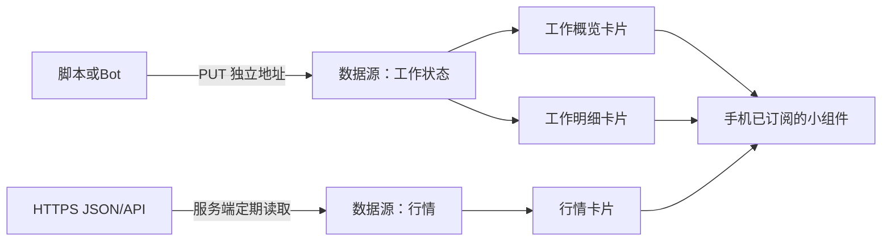

# 创建与接入卡片

进入Web“卡片工作台”，默认打开“我的卡片”：这里列出所有草稿和已发布卡片。可以按卡片或数据源名称查找，查看预览、发布状态，进入“编辑设计”或“接入与订阅”。

控制台右上角可以切换中文/English，以及浅色、深色或跟随系统。这个选择只保存在当前浏览器，不改变卡片数据、订阅或手机上的卡片外观。

## 选择更新方式

| 方式 | 用户提供 | 服务端如何更新 | 典型场景 |
| --- | --- | --- | --- |
| 读取JSON/API | 一个公网HTTPS JSON地址，必要鉴权及字段对应关系 | 按设定周期查询并保存最新数据 | 行情、天气、网站指标、已有查询接口的业务状态 |
| 工具主动上报 | 脚本向专属数据源地址PUT JSON | 每次提交整份替换最新内容 | 备份进度、构建结果、工单变更、内网任务 |

场景不限制接入方式；工单有查询接口也能读取，行情脚本已有采集结果也能上报。更新时机和接口可达性决定选择。手机读取本服务整理后的数据，不直接持有业务API密钥。

## 三步创建

1. **接入数据**：点“新建卡片”，命名，选择独立数据源或共用已有数据源，再选读取/上报及起始布局。已有JSON如`{"data":{"value":"68"}}`，数值字段路径填`data.value`。鉴权和列表映射可以在数据源管理补充。
2. **设计样式**：数据未接入时页面展开指引；脚本上报、读取API或在网页按字段填值。选择左侧显示项，从下拉框绑定实际字段，修改名称/字号并查看右侧预览。复杂布局打开“高级布局”，也可导入JSON。没有有效数据或字段不匹配时，页面明确阻止发布。
3. **发布订阅**：保存草稿只保存编辑进度，点“发布到设备”才改变手机可读设计。进入“接入与订阅”，生成订阅码；手机连接同一服务器后在“卡片 → ＋ → 通过订阅码导入”添加。导入后再添加系统桌面小组件。

卡片发布后，日常只更新数据源内容即可。样式需要改变时才再次编辑并发布；无需每次生成订阅码。页面支持查看订阅设备、取消某设备订阅、停用旧码和重新生成码。

## 删除卡片与数据源

“我的卡片 → 删除卡片”或“接入与订阅 → 删除这张卡片”会先列出该卡片及订阅设备，确认后永久删除卡片、订阅码和读取授权，保留数据源及其他卡片。

“数据源管理 → 删除”先检查引用。只要还有卡片使用它（未发布草稿也算），就不能删除；点“查看关联卡片”处理这些卡片。确认没有引用后才能删除数据源，原上报地址将失效，自动采集停止，最新内容与采集配置一并清除。取消确认不更改数据，没有回收站。手机离线缓存不会立即消失，下次同步或读取后才显示不可用。

确认期间若卡片或订阅发生变化，页面会要求重新查看引用；检查最新范围后再确认。普通数据更新无需重新确认。删除操作不改变默认消息接收设备。

## 脚本如何区分多张卡片

数据源有自己的写入地址，卡片固定绑定数据源，订阅码建立手机读取卡片的权限。三者用途分别是数据更新、排版与设备导入。



独立卡片：分别创建“行情”“服务器状态”数据源，脚本向各自地址提交。共用数据：概览和明细选择同一数据源，上报一次，两张卡片读取同一最新内容，样式各自保留。在每卡“接入与订阅”页可看到数据源名称及使用它的卡片。

该页提供专属地址、匹配当前字段的完整curl示例和请求体。地址含写入凭据，只有需要更新此源的工具应持有。一个示例：

```sh
curl -X PUT 'https://push.example.com/v1/card-data/SOURCE_WRITE_KEY' \
  -H 'Content-Type: application/json' \
  --data-raw '{"fields":{"progress":{"type":"percent","label":"完成率","value":"68"},"status":{"type":"text","label":"状态","value":"进行中"}}}'
```

每次写入替换整份状态，不是追加任务日志。需要完成/失败提醒时，可以另外向消息端点发通知。HTTP 200/202只证明数据保存，不表示系统桌面已绘制，也不保证严格一分钟刷新。

## AI辅助生成卡片

「我的卡片 → 新建卡片」在读取接口和工具上报之外提供「AI辅助生成」。用户填写 HTTPS 地址、API Key，并用自己的话说明这个接口要展示什么。点击「生成说明」后交给自己的模型；说明不包含 API Key。把返回的 JSON 贴回并保存，会创建读取型数据源和一张草稿卡片，并打开设计页。密钥由服务器加密保存，并按 `Authorization: Bearer` 发送。字段路径、请求头等专业配置仍留在原来的添加方式里。

## AI辅助设计完整示例

工作台“AI辅助设计”明确展示输入、要求、结果和原生布局预览。以任务进度为例，输入含`progress`完成率和`status`状态；用户要求“中间突出完成率，下面显示状态，整体简洁”。

示例输入见[任务数据](../examples/cards/task-data.json)，有效输出见[设计JSON](../examples/cards/task-design.json)。实际使用时：

1. 在“描述展示效果”填写偏好。
2. 复制完整说明到用户选择的AI。说明含当前字段结构、组件规则和当前布局，不包含数据源URL或接口鉴权。
3. 粘贴AI返回的JSON，点击“校验并预览”。错误保留输入；成功只改当前草稿。
4. 检查字段和尺寸，保存并发布。已微调组件的稳定ID应保留。

页面示例是用于说明的完整输入/输出，不表示产品内置模型或自动调用外部AI。离开未保存设计时可选择继续编辑、保存草稿或放弃本次修改。
